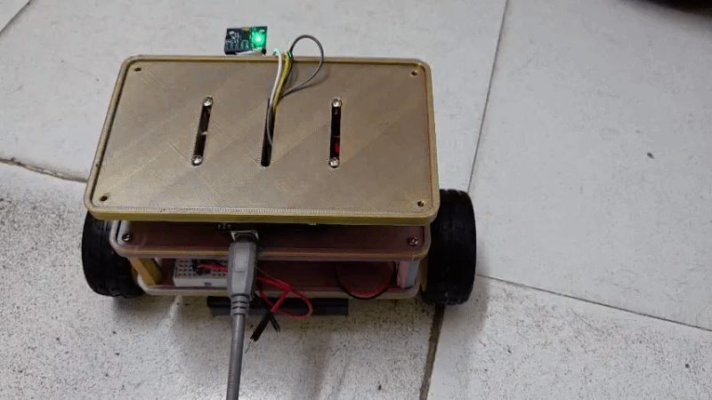
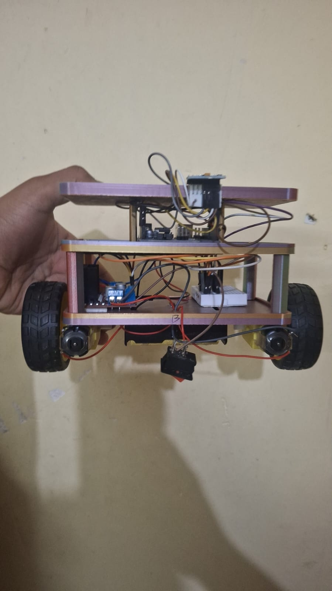
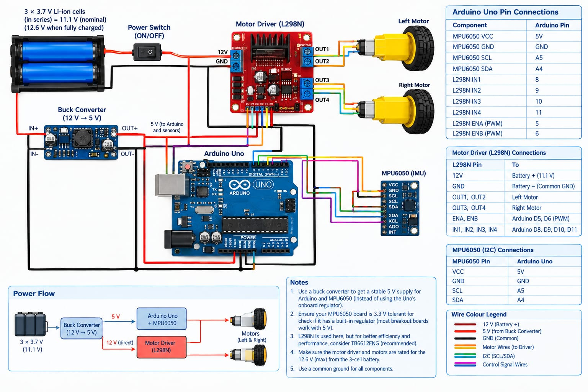
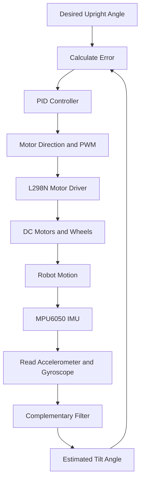
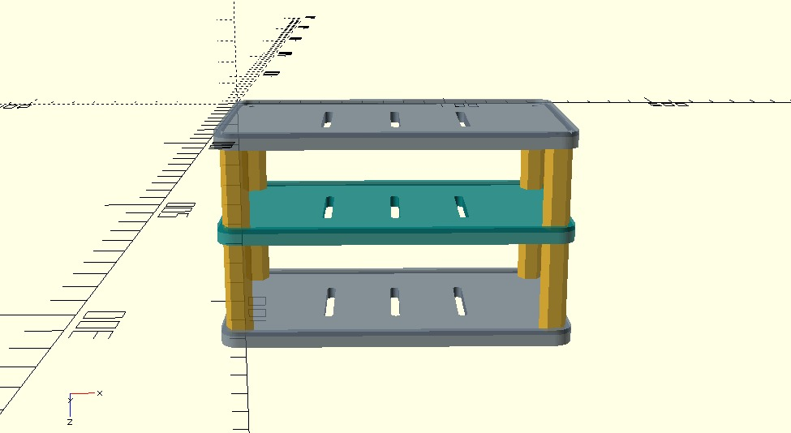

# Arduino Self-Balancing Robot

A two-wheeled self-balancing robot developed using Arduino, an MPU6050 IMU, an L298N motor driver, and PID-based feedback control.

The project integrates embedded programming, sensor fusion, control systems, electronics, and mechanical CAD design.

**Project status:** Prototype under development; reliable sustained balancing is still being improved.

## Robot Demonstration



*Animated demonstration of the current robot prototype.*

## Project Overview

A self-balancing robot behaves like an inverted pendulum. It continuously measures its tilt and moves its wheels to keep its body near the upright position.

The MPU6050 provides accelerometer and gyroscope measurements. The controller estimates the robot's tilt, calculates a corrective response, and sends motor commands through the L298N driver.

## Team Members

This is a collaborative engineering project involving five team members.

| Team member | Student ID | Responsibility |
|---|---|---|
| Disha Singh | 1MS24AI019 | Programming & Communication |
| Sanjana N | 1MS24EC104 | Electronics & Hardware |
| Gokul L | 1MS24MD014 | Mechanical Design |
| Suraj Kariyappanavar | 1MS25EE059 | Testing & Documentation |
| Aditya Chevuri | 1MS25EC007 | Control System |

## Hardware Components

| Component | Purpose |
|---|---|
| Arduino Uno | Main controller |
| MPU6050 | Accelerometer and gyroscope |
| L298N motor driver | DC motor direction and speed control |
| DC geared motors | Wheel actuation |
| Wheels and chassis | Mechanical structure |
| Battery and power circuitry | System power |

## Hardware Setup



*Hardware arrangement of the robot prototype.*

## Circuit Design



*Circuit design reference for the electronics and motor connections.*

### MPU6050 Connections

| MPU6050 | Arduino Uno | Purpose |
|---|---|---|
| VCC | Compatible supply | Sensor power |
| GND | GND | Ground |
| SDA | A4 | I²C data |
| SCL | A5 | I²C clock |
| AD0 | GND for address `0x68` | Address selection |

Confirm the voltage requirements of your specific MPU6050 module.

### L298N Motor Driver Connections

The following assignments match the motor channel defined in the main firmware.

| L298N | Arduino Uno | Purpose |
|---|---|---|
| ENA | D9 | PWM speed control |
| IN1 | D2 | Direction control |
| IN2 | D3 | Direction control |
| OUT1, OUT2 | DC motor terminals | Motor output |
| GND | Common ground | Electrical reference |

Verify the physical wiring and the second motor channel against the actual circuit before powering the robot.

**Power note:** Supply the motors through a suitable motor supply and driver. Do not power the motors directly from Arduino GPIO pins.

## System Architecture

The control system consists of the following stages:

1. **Sensor acquisition:** Read accelerometer and gyroscope measurements from the MPU6050.
2. **Tilt estimation:** Combine both measurements using a complementary filter.
3. **Error calculation:** Compare the estimated angle with the desired upright angle.
4. **PID control:** Calculate the corrective control output.
5. **Motor actuation:** Convert the output into direction and PWM commands.
6. **Feedback:** Measure the resulting motion and repeat the process.

## Control System

### 1. Tilt Angle Estimation

The accelerometer provides a tilt estimate but can be affected by vibration and linear acceleration. The gyroscope responds quickly to rotation but accumulates drift when its angular velocity is integrated over time.

A complementary filter combines both measurements.

$$
\theta_k =
\alpha\left(\theta_{k-1}+\omega_k\Delta t\right)
+(1-\alpha)\theta_{\mathrm{acc},k}
$$

Where:

- \(\theta_k\): current estimated tilt angle
- \(\theta_{k-1}\): previous estimated tilt angle
- \(\omega_k\): measured angular velocity
- \(\Delta t\): elapsed time between updates
- \(\theta_{\mathrm{acc},k}\): accelerometer-derived tilt angle
- \(\alpha\): filter coefficient between 0 and 1

The gyro and accelerometer angles must use compatible units and the same physical axis.

### 2. Error Calculation

The controller compares the target angle with the estimated angle.

$$
e(t)=\theta_{\mathrm{target}}-\theta_{\mathrm{estimated}}
$$

The target is near the calibrated upright position. The error and motor direction signs must be consistent so that the wheels correct the fall rather than increase it.

### 3. PID-Based Control

The controller computes its output using proportional, integral, and derivative contributions.

$$
u(t)=K_p e(t)+K_i\int_0^t e(\tau)\,d\tau
+K_d\frac{de(t)}{dt}
$$

Where:

- \(K_p\): proportional gain
- \(K_i\): integral gain
- \(K_d\): derivative gain
- \(e(t)\): tilt error
- \(u(t)\): controller output

**Proportional:** Responds to the current error.

**Integral:** Compensates for persistent error.

**Derivative:** Adds damping based on how quickly the error changes.

The actual implementation may use gyroscope feedback for the derivative-related term. The exact implementation should be checked against the source code.

### 4. Motor Control

The control output is converted into motor direction and PWM commands. The L298N drives the motors so the wheels move underneath the robot's centre of mass.

For example, a forward tilt generally requires the wheels to move forward to catch the falling body. The opposite correction is required for a backward tilt.

### 5. Closed-Loop Control Diagram



This is a closed-loop feedback system because the robot's movement changes the next sensor measurements, which influence the next motor correction.

## CAD and Mechanical Design



The mechanical models are available in the [`cad/`](cad/README.md) directory.

- [CAD documentation](cad/README.md)
- [Plate model](cad/plate.stl)
- [Rod models](cad/rods.stl)

Mechanical design considerations include chassis rigidity, motor alignment, sensor mounting, battery placement, and centre of gravity.

## Software and Testing

### Main Firmware

[`src/self-balancing-robot.ino`](src/self-balancing-robot.ino)

### Test Sketches

- [MPU6050 test](tests/mpu6050-test.ino)
- [Motor test](tests/motor-test.ino)
- [Balance test](tests/balance-test.ino)
- [Balancing test log](tests/balancing-tests.md)

The sensor and motor tests help isolate hardware issues before testing the complete balancing controller.

### Getting Started

1. Install the Arduino IDE.
2. Open the main firmware sketch.
3. Select the appropriate board and serial port.
4. Install any required libraries.
5. Compile and upload the sketch.
6. Verify sensor readings and motor direction before attempting balancing tests.

## Current Challenges

The following areas require continued investigation and testing:

- PID tuning and oscillation reduction
- Sensor calibration and orientation
- Motor direction and PWM calibration
- Power stability under motor load
- Reliable sensor communication
- Control-loop timing and fault handling
- Consistent, sustained balancing

## Future Improvements

### Control and Firmware

- Systematic PID tuning
- Integral windup prevention
- Improved sensor filtering and calibration
- More reliable sensor-failure handling
- Consistent control-loop timing
- Independent motor control and calibration

### Hardware and Mechanical Design

- Improved power regulation and noise reduction
- Motor current and supply-voltage monitoring
- Better chassis and component alignment
- Editable native CAD files and dimensioned drawings
- Improved battery placement and weight distribution

### Testing and Documentation

- Measure balancing duration
- Record tilt response and recovery behaviour
- Compare controller parameters across test sessions
- Add annotated circuit diagrams and physical robot photographs
- Document repeatable results and firmware revisions

## Repository Structure

```text
arduino-self-balancing-robot/
├── README.md
├── LICENSE
├── .gitignore
├── cad/
│   ├── README.md
│   ├── cad-design.jpeg
│   ├── plate.stl
│   └── rods.stl
├── src/
│   ├── circuit-design.jpeg
│   ├── hardware-setup.jpeg
│   ├── self-balancing-robot-demo.gif
│   └── self-balancing-robot.ino
└── tests/
    ├── balance-test.ino
    ├── balancing-tests.md
    ├── motor-test.ino
    └── mpu6050-test.ino
```

## Safety

- Keep the robot supported during initial testing.
- Keep the wheels clear of the ground during motor direction tests.
- Disconnect power before changing wiring.
- Verify motor-driver and battery ratings.
- Stop testing if the robot behaves unexpectedly or any component overheats.

## License

See [`LICENSE`](LICENSE) for the applicable license terms.

---

*Collaborative engineering project in embedded systems, robotics, sensor fusion, control systems, and mechanical design.*
